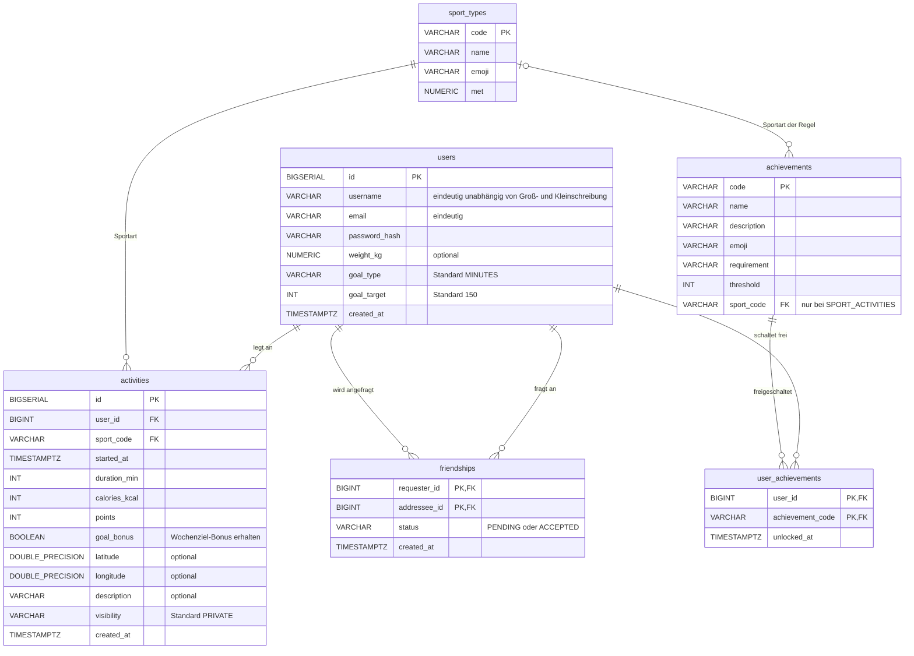
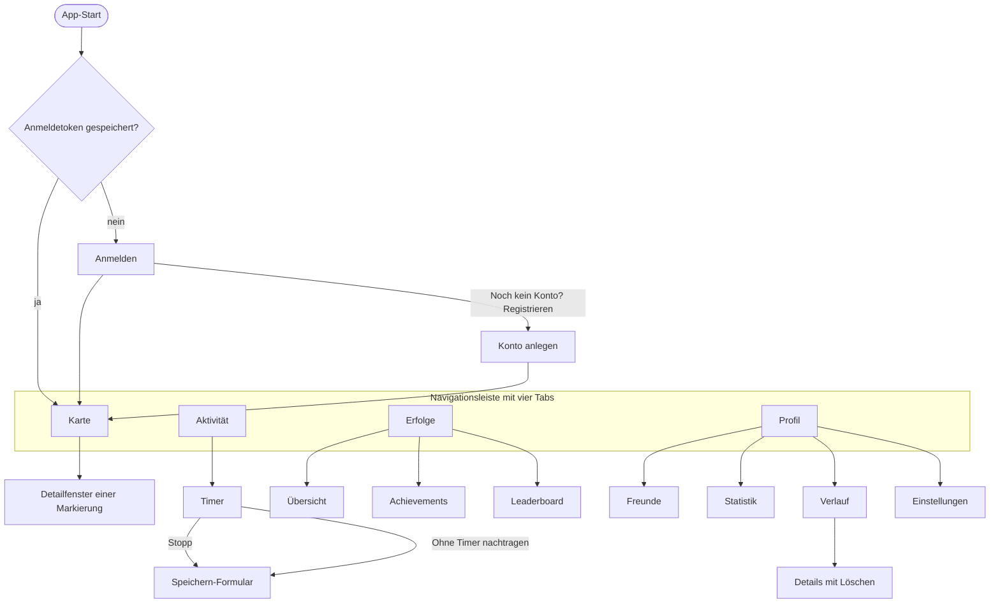
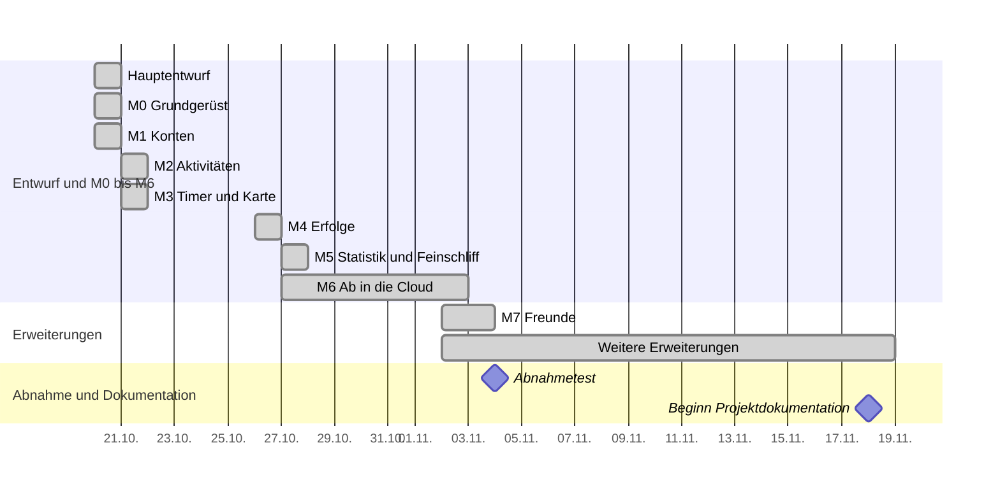
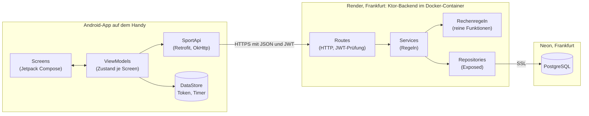
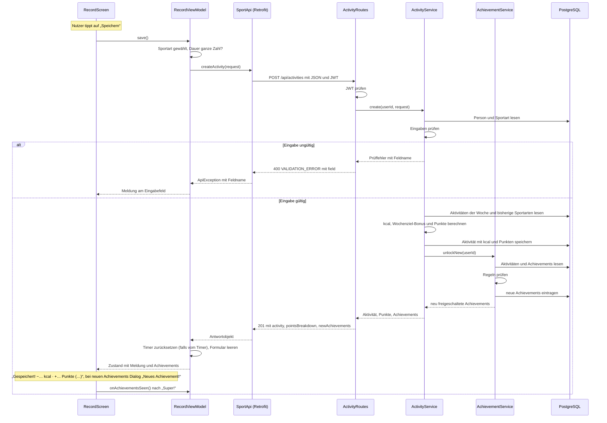

# Projektdokumentation TouchGrass

<!--
Gliederung nach dem Leitfaden der Berufsschule, siehe vorgaben.md.
Umfang: 5 bis 20 Seiten ohne Deckblatt, Verzeichnisse, Grafiken und Anhang. Ziel sind rund 16 Seiten,
die Seitenzahlen hinter den Kapiteln sind Richtwerte. Details wandern in den Anhang (höchstens 20 Seiten).
Für die Abgabe wird daraus ein Word- und PDF-Dokument mit der Formatierung aus vorgaben.md.
Abbildungen und Tabellen fortlaufend nummerieren, darunter die Quelle oder „Eigendarstellung“.
-->

## Deckblatt

- Staatliche Berufsschule Lauingen, Friedrich-Ebert-Straße 14, 89415 Lauingen a. d. Donau
- Thema: „Standalone-Applikation für sportliche Tätigkeiten“ – TouchGrass
- Betreuungslehrkraft: [Name der Betreuungslehrkraft]
- Abgabe: [Datum der Abgabe]
- Gruppe: Nils Appel, Michael Lafutkin

## Inhaltsverzeichnis

[Inhaltsverzeichnis in Word aus den Überschriften mit Seitenzahlen erzeugen; diese Seite ohne Seitenzahl]

## Abkürzungsverzeichnis

| Abkürzung | Bedeutung |
|---|---|
| API | Application Programming Interface, Programmierschnittstelle |
| APK | Android Package, Installationspaket einer Android-App |
| CPU | Central Processing Unit, Prozessor |
| CU | Compute Unit, Recheneinheit beim Datenbankanbieter Neon |
| DIN | Deutsches Institut für Normung |
| FK | Foreign Key, Fremdschlüssel |
| GB, MB | Gigabyte, Megabyte |
| GPS | Global Positioning System, satellitengestützte Ortsbestimmung |
| HTTP, HTTPS | Hypertext Transfer Protocol, Übertragungsprotokoll im Web; HTTPS ist die verschlüsselte Form |
| JDK | Java Development Kit, Werkzeuge zum Entwickeln mit Java |
| JSON | JavaScript Object Notation, Textformat für Daten |
| JWT | JSON Web Token, signiertes Anmeldetoken |
| kcal | Kilokalorie |
| KI | künstliche Intelligenz |
| MET | Metabolic Equivalent of Task, metabolisches Äquivalent |
| MVP | Minimum Viable Product, kleinster sinnvoll nutzbarer Funktionsumfang |
| PK | Primary Key, Primärschlüssel |
| REST | Representational State Transfer, Architekturstil für Web-Schnittstellen |
| SQL | Structured Query Language, Abfragesprache für Datenbanken |
| SSL | Secure Sockets Layer, Verschlüsselung von Verbindungen |

## 1 Einleitung

Das Projekt bearbeitet das Thema „Standalone-Applikation für sportliche Tätigkeiten“. Die Idee des Teams ist eine App, mit der ihre Nutzer sportliche Tätigkeiten eintragen, einen geschätzten Kalorienverbrauch einsehen und sich mit Freunden und Familie vergleichen. Der Name TouchGrass greift die englische Redewendung „touch grass“ auf, mit der man jemanden auffordert, nach draußen zu gehen.

Als Handlungsprodukt entsteht eine installationsbereite Android-App. Auf einer Karte mit Daten von OpenStreetMap setzt man eine Markierung für eine sportliche Aktivität und kann ihr künftig optional ein Foto beifügen. Sechs Achievements (Auszeichnungen) belohnen erreichte Ziele, etwa die erste Aktivität oder sieben Tage Sport in Folge, und in einem Leaderboard (Rangliste) messen sich die Nutzer mit ihren Freunden.

Eigenständig („standalone“) bedeutet hier, dass eine einzige App alle Funktionen für den Nutzer enthält. Installiert wird sie als APK, das Installationspaket für Android; weitere Software braucht das Handy nicht. Konten, Aktivitäten und Auswertungen verwaltet ein Backend – ein Serverprogramm, das das Team selbst entwickelt und bei einem Anbieter im Internet (Cloud) betreibt. Die App braucht deshalb eine Internetverbindung. Das Thema umfasst damit die mobile App, eine Schnittstelle, das Backend mit Datenbank und dessen Betrieb.

## 2 Ausgangssituation und Problemstellung

### 2.1 Ist-Zustand

Zu Beginn des Projekts am 20.10.2026 gab es weder eine App noch ein Backend. Das Repository auf GitHub, die Ablage des Quellcodes mit Versionsverwaltung, enthielt nur die Projektvorlage der Entwicklungsumgebung Android Studio. Das Team aus zwei Personen arbeitet mit eigenen Rechnern und Android-Handys.

### 2.2 Problemstellung

Aus der Projektidee ergeben sich fünf Teilprobleme. Erstens sollen sich Aktivitäten während des Sports mit einem Timer oder nachträglich von Hand eintragen lassen, jeweils mit Sportart, Dauer und optional dem Ort. Zweitens lässt sich der Kalorienverbrauch ohne Messgerät nur schätzen. Dafür braucht die App das Körpergewicht und einen Kennwert je Sportart. Drittens setzt der Vergleich mit Freunden und Familie voraus, dass die Daten mehrerer Personen an einem gemeinsamen Ort liegen. Die App benötigt deshalb Benutzerkonten und einen zentralen Server mit Datenbank. Viertens sind Körpergewicht und Orte persönliche Daten, sodass jede Person festlegen können muss, wer ihre Aktivitäten sieht. Fünftens sollen Achievements, ein Wochenziel und ein Leaderboard zu regelmäßigem Sport anregen.

### 2.3 Grundlagen

Eine App läuft auf dem Handy und stellt die Oberfläche dar. Das Backend ist ein Programm auf einem Server: Es speichert die Daten, berechnet Werte und beantwortet die Anfragen der App über eine Programmierschnittstelle (API). TouchGrass nutzt dafür eine REST-API. Die App ruft Adressen wie `/api/activities` über HTTPS auf und tauscht die Daten im Textformat JSON aus. Nach der Anmeldung erhält die App ein signiertes Anmeldetoken, ein JSON Web Token (JWT). Sie schickt es bei jeder Anfrage mit, und das Backend erkennt daran die Person.

Den Kalorienverbrauch schätzt TouchGrass über das metabolische Äquivalent (MET). Ein MET entspricht dem Ruheumsatz von rund 1 kcal je Kilogramm Körpergewicht und Stunde. Bei einer Tätigkeit mit 8 MET verbraucht der Körper demnach etwa das Achtfache des Ruheumsatzes (Vgl. Herrmann, Stephen D. et al., 2024, S. 6–12). Das Backend rechnet kcal = MET × Körpergewicht in kg × Dauer in Stunden. Das Ergebnis bleibt eine Schätzung, denn die MET-Werte bilden den Verbrauch einer einzelnen Person nicht genau ab (Vgl. Herrmann, Stephen D. et al., 2024, S. 6–12).

Die Karte der App zeigt Kartendaten von OpenStreetMap. Diese stellt der Dienst OpenFreeMap kostenlos, ohne Registrierung und ohne API-Schlüssel bereit (Vgl. OpenFreeMap, o. J.).

## 3 Leistungsbeschreibung

### 3.1 Soll-Zustand und Zielbestimmung

Im Soll-Zustand erfasst eine Person ihre sportlichen Aktivitäten mit dem Handy, sieht sie auf einer Karte und erhält Punkte, Achievements und einen Platz im Leaderboard.

Musskriterien bilden das MVP (Minimum Viable Product), den festen Mindestumfang des Projekts. Wunschkriterien sind die Stretch Goals: Erweiterungen, die erst nach dem MVP mit jeweils eigenem Entwurf entstehen. Abgrenzungskriterien nennen, was das Produkt nicht leisten soll (Tab. 1).

| Art | Kriterium | Stand |
|---|---|---|
| Muss | Benutzerkonto: registrieren, anmelden, abmelden, Profil, Passwort ändern, Konto löschen | umgesetzt |
| Muss | Aktivität per Timer oder von Hand erfassen, mit geschätzten Kilokalorien (kcal) | umgesetzt |
| Muss | Karte mit eigenen und öffentlichen Aktivitäten, Verlauf mit Filtern | umgesetzt |
| Muss | Achievements, Wochenziel, Serie (Tage in Folge mit Sport), Leaderboard nach Punkten oder Minuten | umgesetzt |
| Muss | Statistiken mit Diagrammen | umgesetzt |
| Muss (seit 27.10.2026) | Betrieb des Backends in der Cloud | umgesetzt |
| Wunsch | Freunde: Anfragen per Benutzername, Sichtbarkeit „Freunde“, Leaderboard unter Freunden | umgesetzt |
| Wunsch | Fotos zu Aktivitäten | entworfen |
| Wunsch | GPS-Tracking: Strecke während der Aktivität aufzeichnen | geplant |
| Abgrenzung | Höhenmeter, Navigation und Routenplanung, Offline-Betrieb, Bearbeiten gespeicherter Aktivitäten; aus den Entwürfen der Erweiterungen unter anderem Push-Benachrichtigungen (Freunde) und Videos (Fotos) | nicht vorgesehen |

Tab. 1: Zielbestimmung, Stand 18.11.2026 (Eigendarstellung)

Durch den Cloud-Betrieb braucht die App kein lokal gestartetes Backend und lässt sich an andere Personen weitergeben.

### 3.2 Produkteinsatz

**Anwendungsbereich:** TouchGrass ist eine Sport-App für Android mit eigenem Backend.

**Zielgruppe:** Die App richtet sich an Menschen, die ihre sportlichen Tätigkeiten festhalten, ihren Kalorienverbrauch abschätzen und sich mit Freunden und Familie vergleichen wollen. Einen externen Auftraggeber gibt es nicht, die Anforderungen legte das Team selbst fest.

**Betriebsbedingungen:** Die App setzt Android 8.0 oder neuer und eine Internetverbindung voraus. Ohne Netz läuft nur ein gestarteter Timer weiter, die übrigen Funktionen und die Kartenbilder brauchen das Internet. Backend und Datenbank laufen im kostenlosen Tarif der Cloud-Anbieter Render und Neon. Nach 15 Minuten ohne Anfrage versetzt Render den Server in einen Ruhezustand, die erste Anfrage danach dauert etwa eine Minute (Vgl. Render, o. J. a).

### 3.3 Produktumgebung

Tab. 2 ordnet die Produktumgebung nach Hardware, Software und Orgware, den organisatorischen Rahmenbedingungen.

| Bereich | Betrieb | Entwicklung und Test |
|---|---|---|
| Hardware | Handy ab Android 8.0; Server bei Render im kostenlosen Tarif (siehe 5.5); Datenbank bei Neon mit 1 GB Speicherplatz | Windows-Rechner; Samsung Galaxy A34 und ein zweites Handy; Emulator (virtuelles Android-Gerät) |
| Software | App und Backend in der Programmiersprache Kotlin; Backend als Docker-Container mit Java 21; PostgreSQL bei Neon; Kartendienst OpenFreeMap | Entwicklungsumgebung Android Studio mit Java Development Kit (JDK); eingebettetes PostgreSQL 18.6, vom Backend selbst gestartet |
| Orgware | Konten des Teams bei Render und Neon | Git-Repository bei GitHub; API-Vertrag (verbindliche Beschreibung der Schnittstelle), Anleitung (README) und Testcheckliste (Anhang C) |

Tab. 2: Produktumgebung (Eigendarstellung)

Docker verpackt das Backend samt Java-Laufzeitumgebung in einen Container, den Render startet.

### 3.4 Datenstruktur

Die Daten liegen in PostgreSQL, einer relationalen Datenbank mit verknüpften Tabellen. Ein Primärschlüssel (PK) kennzeichnet dort eine Zeile eindeutig, ein Fremdschlüssel (FK) verweist auf eine Zeile einer anderen Tabelle. Das Datenbankschema, der Aufbau der Tabellen, entsteht aus den Migrationen V1 bis V7. Das sind nummerierte Dateien mit Befehlen in der Abfragesprache SQL, die das Werkzeug Flyway beim Start des Backends einspielt (Abb. 1).



Abb. 1: Datenmodell nach den Migrationen V1 bis V7 (Eigendarstellung)

Die 25 Sportarten in `sport_types` tragen je einen MET-Wert (siehe 2.3). Die Tabelle `activities` speichert die beim Anlegen berechneten kcal und Punkte, damit eine spätere Gewichtsänderung alte Werte nicht verändert. In `friendships` steht je Paar nur eine Zeile, der Status PENDING bedeutet „Anfrage offen“, ACCEPTED „befreundet“. Löscht eine Person ihr Konto, entfernt die Datenbank über die Regel ON DELETE CASCADE ihre Aktivitäten, freigeschalteten Achievements und Freundschaften mit.

### 3.5 Produktfunktionen

**Benutzerfunktionen:** Sie entsprechen den umgesetzten Kriterien aus 3.1. Hinzu kommen die Anmeldung mit Benutzername oder E-Mail-Adresse und die Pause im Timer. Beim Speichern einer Aktivität lassen sich Ort und Beschreibung angeben und die Sichtbarkeit wählen: „Privat“, „Freunde“ oder „Öffentlich“. Der Verlauf filtert nach Sportart und Zeitraum. Freundschaftsanfragen lassen sich annehmen, ablehnen oder zurückziehen, bestehende Freundschaften lassen sich beenden.

**Systemfunktionen:** Das Backend prüft die Eingaben, etwa eine Dauer von 1 bis 1.440 Minuten. Ob eine Angabe realistisch ist, prüft es nicht. Es entscheidet nach der Sichtbarkeit, wer eine Aktivität sehen darf, und berechnet die Kennzahlen nach Tab. 3.

| Kennzahl | Regel |
|---|---|
| kcal | MET × Gewicht in kg × Minuten / 60, gerundet; ohne Gewicht mit 70 kg |
| Punkte | 1 je Minute, 10 je Aktivität, 20 für die erste Aktivität einer Sportart, 50 beim Erreichen des Wochenziels (höchstens einmal pro Woche) |
| Wochenziel | Minuten, Anzahl der Aktivitäten oder kcal der laufenden Woche, je nach Zielart |
| Serie | Tage in Folge mit Aktivität bis heute; fehlt heute eine Aktivität, zählt die Serie bis gestern; dazu die längste Serie |
| Achievements | freigeschaltet, sobald ein Wert (Anzahl, Minuten, kcal, Anzahl je Sportart, längste Serie) den Schwellenwert erreicht; bleiben auch nach dem Löschen der auslösenden Aktivität erhalten |
| Leaderboard | Summe der Punkte oder Minuten in Woche oder Monat, wahlweise nur unter Freunden; gleicher Wert, gleicher Rang (1, 2, 2, 4); die besten 50 und der eigene Rang |
| Statistik | Zahlen der laufenden Woche, Minuten pro Woche über acht Wochen, Aktivitäten je Sportart, kcal pro Monat über sechs Monate |

Tab. 3: Rechenregeln des Backends (Eigendarstellung)

Beispiel: 45 Minuten Joggen (MET 8,0) ergeben bei 80 kg Körpergewicht 480 kcal, angezeigt als „~480 kcal“. Das Leaderboard wertet keine kcal, weil sonst das Körpergewicht den Rang mitbestimmen würde.

**Administratorfunktionen:** Eine Administratorrolle hat das Produkt nicht. Neue Sportarten oder Achievements mit einer der fünf Regeln ergänzt das Team als SQL-Zeilen in einer neuen Migration, ohne Code-Änderung und App-Update. Den Betrieb steuert es über die Verwaltungsoberflächen von Render und Neon und überwacht ihn mit der Statusabfrage `/api/health` (Health-Check, siehe 5.5).

### 3.6 Qualitätsanforderungen

**Datenschutz:** Ort und Gewicht sind freiwillig, neue Aktivitäten sind zunächst „Privat“. Die Standortberechtigung fragt die App erst beim Antippen von „Mein Standort“ oder „Aktueller Standort“ ab. Wer welche Daten sieht, zeigt Tab. 4.

| Daten | Zweck | Sichtbar für |
|---|---|---|
| Benutzername | Anmeldung, Leaderboard, öffentliche Markierungen | angemeldete Personen |
| E-Mail-Adresse, Passwort-Hash | Anmeldung | nur das Backend |
| Gewicht | kcal-Schätzung | nur die Person selbst |
| Aktivitäten mit Ort | Kernfunktion | die Person selbst, bei „Freunde“ ihre Freunde, bei „Öffentlich“ angemeldete Personen |
| Freundschaften und Anfragen | Freunde-Funktion | die beiden Beteiligten |

Tab. 4: Daten, Zweck und Sichtbarkeit (Eigendarstellung)

Im Leaderboard zählen auch private Aktivitäten mit, andere sehen dort nur Benutzername und Summe. Das Löschen des Kontos (siehe 3.4) setzt das Recht auf Löschung um. Das Backend schreibt keine Anfragen in sein Protokoll. Server und Datenbank stehen in Frankfurt.

**Sicherheit:** Passwörter speichert das Backend nur als BCrypt-Hash. Aus diesem berechneten Wert lässt sich das Passwort nicht zurückrechnen. Das Anmeldetoken (JWT, siehe 2.3) gilt 30 Tage und lässt sich nicht vorzeitig sperren. Schlüssel und Zugangsdaten liegen nicht im Git-Repository. Die Verbindung zwischen App und Render ist über HTTPS verschlüsselt, die zwischen Render und Neon über SSL.

**Korrekte Zeitgrenzen:** Tag, Woche und Monat rechnet das Backend in der Zeitzone Europe/Berlin, weil Schule und Nutzer in Deutschland sind. Die Woche beginnt am Montag um 0 Uhr. Die Grenzen müssen auch bei Zeitumstellung und Jahreswechsel stimmen.

**Bedienbarkeit und Verhalten bei Fehlern:** Vor nicht umkehrbaren Aktionen wie dem Löschen einer Aktivität oder des Kontos fragt die App nach. Eingabefehler erscheinen am betroffenen Feld. Screens (Bildschirmseiten) mit Daten aus dem Backend zeigen im Fehlerfall die Meldung und „Erneut versuchen“, ohne Verbindung „Server nicht erreichbar“. Im Ruhezustand des Servers wartet die App bis zu zwei Minuten und weist nach fünf Sekunden auf den Serverstart hin.

**Testabdeckung:** Rechenregeln einschließlich der Zeitgrenzen, Prüfregeln und Schnittstelle sollen automatisiert getestet werden, die Oberfläche von Hand anhand einer Testcheckliste auf zwei Handys (siehe 5.4).

### 3.7 Benutzeroberfläche

**Bedienkonzept:** Die deutschsprachige Oberfläche folgt dem Designsystem Material 3, ihre Farben leiten sich aus dem Logo ab. Eine Navigationsleiste am unteren Rand führt über vier Reiter (Tabs) zu den Bereichen „Karte“, „Aktivität“, „Erfolge“ und „Profil“ (Abb. 2).



Abb. 2: Navigationsstruktur der App (Eigendarstellung)

[offen: Screenshots (Anmeldung, Karte mit Detailfenster, Timer, Speichern-Formular, Erfolge, Profil) mit Abbildungszeilen.]

**Schnittstellen-Bedienkonzept:** App und Backend tauschen Daten über die REST-API aus (siehe 2.3). Sie bietet 22 Endpunkte unter `https://touchgrass-backend-pfz7.onrender.com/api`. Ein Endpunkt ist eine Kombination aus HTTP-Methode und Adresse, etwa GET (abrufen) oder DELETE (löschen) mit `/activities/{id}`. Außer Health-Check, Registrierung und Anmeldung verlangen die Aufrufe das JWT im Header, dem Kopfbereich der Anfrage: `Authorization: Bearer <Token>`. Fehler haben ein einheitliches Format:

```json
{ "error": "VALIDATION_ERROR", "message": "Die Dauer muss zwischen 1 und 1440 Minuten liegen.", "field": "durationMin" }
```

Der HTTP-Statuscode, eine dreistellige Kennzahl der Antwort, ordnet den Fehler ein, etwa 400 für ungültige Eingaben oder 401 für ein fehlendes oder ungültiges Anmeldetoken. Bei 401 auf eine Anfrage mit Anmeldetoken meldet die App die Person ab. Verbindlich ist der API-Vertrag `docs/api.md`, Endpunkte und Fehlercodes fasst Anhang B zusammen.

## 4 Projektplanung

### 4.1 Vorgehensmodell

Der Leitfaden der Schule nennt für die Projektarbeit die Phasen nach DIN 69901, der deutschen Norm zum Projektmanagement (Vgl. Staatliche Berufsschule Lauingen, o. J., S. 2). Tab. 5 überträgt sie auf TouchGrass.

| Phase | Umsetzung bei TouchGrass |
|---|---|
| Initialisierung | Anmeldung des Themas [Datum der Anmeldung]; Repository am 20.10.2026 auf GitHub angelegt |
| Definition | Hauptentwurf vom 20.10.2026 mit MVP, Erweiterungen, Abgrenzung, Architektur, Datenmodell und Schnittstelle; eigene Entwürfe für Freunde (02.11.2026) und Fotos (18.11.2026) |
| Planung | je Meilenstein ein Umsetzungsplan, insgesamt 8 Pläne mit 55 Aufgaben |
| Steuerung | Umsetzung Aufgabe für Aufgabe, Kontrolle durch automatisierte Tests und eine Testcheckliste, Anpassung der Meilensteine (siehe 4.2) |
| Abschluss | Abnahmetest mit zwei Handys am 04.11.2026, Projektdokumentation seit 18.11.2026; vorgesehen: Abgabe von App, Dokumentation und Präsentation |

Tab. 5: Phasen nach DIN 69901 im Projekt TouchGrass (Eigendarstellung)

Innerhalb dieser Phasen entstand das Produkt schrittweise in Meilensteinen (inkrementelles Vorgehen). Ein Meilenstein ist ein Zwischenziel, das laut Hauptentwurf mit einem vorführbaren Ergebnis endet. Sein Umsetzungsplan zerlegt die Arbeit in Aufgaben mit festen Arbeitsschritten. Für 45 der 55 Aufgaben sehen die Pläne testgetriebenes Vorgehen vor: Zuerst entsteht ein automatisierter Test, der anfangs fehlschlagen muss. Danach wird Programmcode ergänzt, bis der Test besteht. Abgeschlossen wird eine Aufgabe in der Regel mit einem Commit, einem beschriebenen Änderungsschritt in der Versionsverwaltung Git. So bleiben die Schritte einzeln nachvollziehbar.

### 4.2 Zeitplanung

Der Hauptentwurf nennt einen Rahmen von ein bis drei Monaten, aber keine Termine für einzelne Meilensteine. Einen eigenen Zeitplan mit Terminen erstellte das Team nicht (siehe 7.2). Die erste Fassung des Hauptentwurfs vom 20.10.2026 plante die Meilensteine M0 bis M5, die Freunde-Funktion war dort ein Stretch Goal. Am 27.10.2026 kam M6 für den Betrieb in der Cloud hinzu. Für die Freunde-Funktion entstanden am 02.11.2026 ein eigener Entwurf und der Umsetzungsplan für den neuen Meilenstein M7. Abb. 3 zeigt die tatsächlichen Termine laut Projekttagebuch (Anhang A) und Git-Historie.



Abb. 3: Zeitlicher Ablauf des Projekts (Eigendarstellung)

Unter „Weitere Erweiterungen“ fallen das App-Icon, die Sportart-Suche, die Farben aus dem Logo und der Entwurf für Fotos. M0 bis M7 entstanden innerhalb von 15 Kalendertagen, bis zum 18.11.2026 verzeichnet die Git-Historie Commits an neun Tagen. Den Rahmen setzt die Schule: Am Ende der Informations- und Arbeitsphase (Blockwochen 4 bis 7) wird die Projektdokumentation abgegeben, in den Blockwochen 8 bis 10 folgen die Abgabe der Präsentation und die Präsentationsphase (Vgl. Staatliche Berufsschule Lauingen, o. J., S. 2). [Kalenderdaten der Blockwochen und Abgabetermine laut Teams]

### 4.3 Kostenplanung

Für den Betrieb fallen keine laufenden Kosten an. Render gewährt je Arbeitsbereich (Workspace) 750 kostenlose Betriebsstunden im Monat (Vgl. Render, o. J. a). Da ein Monat höchstens 744 Stunden hat, reicht das für einen Dienst ohne Unterbrechung. Übersteigen die Build-Minuten, die Rechenzeit zum Erstellen des Programms aus dem Quellcode, oder der ausgehende Datenverkehr das Monatskontingent, berechnet Render nur mit hinterlegter Zahlungsmethode einen Aufpreis. Ohne sie setzt Render bis zum Monatsende aus: bei verbrauchtem Datenverkehr die kostenlosen Dienste, bei verbrauchten Build-Minuten jeden weiteren Neubau (Vgl. Render, o. J. a). [offen: ob bei Render eine Zahlungsmethode hinterlegt ist]

Der kostenlose Tarif von Neon bietet je Projekt 1 GB Speicherplatz und 100 CU-Stunden Rechenzeit im Monat. CU-Stunden ergeben sich aus Rechengröße mal Laufzeit, bei 0,25 CU reichen 100 CU-Stunden für etwa 400 Betriebsstunden. Nach fünf Minuten ohne Abfrage pausiert die Datenbank. Sind die CU-Stunden verbraucht, hält Neon die Datenbank bis zum nächsten Abrechnungszeitraum an. Mehrkosten berechnet Neon im kostenlosen Tarif nicht (Vgl. Neon, 2026).

Das Team hält den Server deshalb nicht durch regelmäßige Anfragen aktiv. Sonst bliebe auch die Datenbank aktiv, und die CU-Stunden wären nach rund 17 Tagen verbraucht. Bei geschätzt weniger als 1 MB je tausend Aktivitäten fasst 1 GB rechnerisch mehr als eine Million Aktivitäten.

Die Programmiersprache Kotlin, das Server-Framework (Programmgerüst) Ktor (Vgl. JetBrains, o. J. a; JetBrains, o. J. b), das Datenbanksystem PostgreSQL (Vgl. PostgreSQL Global Development Group, o. J.) und die Kartendaten von OpenFreeMap (siehe 2.3) sind kostenlos nutzbar. Rechner und Handys waren vorhanden (Tab. 6).

| Posten | Kosten |
|---|---|
| Render und Neon im kostenlosen Tarif | 0 € |
| Kotlin, Ktor, PostgreSQL, OpenFreeMap | 0 € |
| Entwicklungsrechner, zwei Handys | vorhanden |
| KI-Assistent Claude Code | [offen: Kosten und Kostenträger] |
| Arbeitszeit | [offen: Arbeitsstunden je Person] |

Tab. 6: Kostenübersicht (Eigendarstellung)

### 4.4 Aufgabenverteilung

Die Planung des Projekts erarbeiteten Nils Appel und Michael Lafutkin gemeinsam. Michael Lafutkin legte am 20.10.2026 das Repository auf GitHub an, das zu seinem Konto gehört; sein Commit enthält die Projektvorlage.

Die übrigen Commits bis zum 18.11.2026 stammen von Nils Appel, zwei davon unter dem GitHub-Konto „NilsSahur“. Dazu gehören die Commits mit Hauptentwurf und Umsetzungsplänen. Backend, App und den Betrieb bei Render und Neon setzte Nils Appel mit dem KI-Assistenten Claude Code um (siehe 6.2). Außerdem testete er die App auf den Handys. Recherche, Zeitplanung und Präsentation hatte das Team bis zum 18.11.2026 noch nicht geplant. [Aufteilung von Projektdokumentation und Präsentation]

## 5 Projektdurchführung

### 5.1 Anforderungsanalyse

Die Anforderungen hielt das Team in Entwürfen fest, die vor der Umsetzung entstanden und bei Änderungen fortgeschrieben wurden. Den Hauptentwurf erstellte Claude Code am 20.10.2026 nach den Vorgaben des Teams (siehe 6.2), bevor der erste eigene Code entstand. Er legt MVP, Stretch Goals und Abgrenzung fest (siehe 3.1).

Je Meilenstein verfeinerte ein Umsetzungsplan die Anforderungen und ergänzte etwa Prüfregeln für Eingaben und genaue Fehlertexte (siehe 4.1). Änderungen an der Schnittstelle trägt das Team zuerst in den API-Vertrag ein (siehe 3.7).

Im Projektverlauf kamen der Cloud-Betrieb als M6 und die Freunde-Funktion als M7 hinzu (siehe 4.2). Wie vorgesehen erhielten die Stretch Goals „Freunde“ (02.11.2026) und „Fotos“ (18.11.2026) eigene Entwürfe. Für das dritte, das GPS-Tracking, fehlt der Entwurf noch.

### 5.2 Entwurf

Nach dem Grundsatz des Hauptentwurfs ist die App nur für Darstellung und Bedienung zuständig. Rechenregeln und Daten liegen im Backend als einziger verbindlicher Quelle. Auf dem Handy speichert die App nur das Anmeldetoken und den Zustand des Timers.

Je Screen hat die App ein ViewModel, das den Zustand des Screens hält und Eingaben verarbeitet. Die Bibliothek Retrofit übersetzt Funktionsaufrufe in Anfragen an die REST-API des Backends (siehe 2.3). Das Backend nutzt das Framework Ktor und hat drei Schichten. Routen nehmen die HTTP-Anfragen an, Service-Klassen setzen die Regeln um, und Repository-Klassen greifen über die Bibliothek Exposed auf die Datenbank zu. Die Rechenregeln sind reine Funktionen, deren Ergebnis nur von den übergebenen Werten abhängt. So lassen sie sich ohne Datenbankzugriff leicht testen. Abb. 4 zeigt die Verteilung auf Handy, Render und Neon im Betrieb.



Abb. 4: Architektur von TouchGrass im Betrieb (Eigendarstellung)

Für die Entwicklung auf dem eigenen Rechner ersetzte das Team noch am 20.10.2026 das zunächst vorgesehene Docker durch ein eingebettetes PostgreSQL (Tab. 2). Umgebungsvariablen sind benannte Werte, die ein Programm beim Start von außen erhält. Ist die Umgebungsvariable `DB_URL` gesetzt, verbindet sich derselbe Code mit einer Datenbank auf einem Server, im Betrieb mit Neon.

Abb. 5 zeigt den Programmablauf vom Antippen von „Speichern“ bis zum Dialog für ein neues Achievement. Die App prüft vorab nur, ob eine Sportart gewählt und die Dauer eine ganze Zahl ist. Die übrigen Prüfungen und die Berechnungen übernimmt das Backend.



Abb. 5: Programmablauf beim Speichern einer Aktivität (Eigendarstellung)

Die Daten hängen eng zusammen: Aktivitäten gehören zu einer Person und einer Sportart, freigeschaltete Achievements zu einer Person. Wochenziel, Leaderboard und Statistik sind Summen über Wochen und Monate. Dafür ist eine relationale Datenbank ausgelegt, die verknüpfte Tabellen mit SQL auswertet. Das Team wählte PostgreSQL, auch weil es kostenlos ist. Tab. 7 nennt die verworfenen Alternativen.

| Alternative | Grund für die Ablehnung |
|---|---|
| Datenbank in der App (SQLite/Room) | Karte, Leaderboard und Anmeldung brauchen gemeinsame Daten. Bei direktem Zugriff auf eine Datenbank im Internet stünde deren Passwort in der App. |
| Firebase (Firestore) | Kein SQL und keine Verknüpfung von Tabellen (Joins). Punkte und Leaderboard liefen in der App oder in Cloud-Funktionen, das eigene Backend fiele weg. |
| Supabase | Basiert auf PostgreSQL, ersetzt mit fertiger Schnittstelle und Anmeldung aber den Teil, den das Team selbst programmieren will. |
| TiDB | Ist zu MySQL statt zu PostgreSQL kompatibel. Die Migrationen müssten umgeschrieben werden, und die Tests mit eingebettetem PostgreSQL passten nicht mehr. |

Tab. 7: Verworfene Alternativen zu PostgreSQL (Eigendarstellung)

Eine eingespielte Migration (siehe 3.4) bleibt unverändert, weil Flyway eine Änderung erkennt und das Backend dann nicht startet. Änderungen an Schema und Startdaten folgen deshalb als neue Migration. Sportarten und Achievements stehen als Daten in Tabellen (siehe 3.5).

Die Oberfläche beschreibt Abschnitt 3.7. Für die Bedienung legt der Entwurf unter anderem das Verhalten des Timers fest: Er speichert Sportart, Startzeit und Pausen auf dem Handy und berechnet daraus die Dauer. So bleibt die Zeitmessung auch nach dem Schließen der App erhalten, ohne dauerhaft laufenden Hintergrunddienst. Zurückgesetzt wird der Timer erst nach erfolgreichem Speichern oder nach „Verwerfen“ mit Rückfrage.

### 5.3 Implementierung

In der App fügt eine Zwischenschicht für HTTP-Anfragen (Interceptor) das Anmeldetoken ein und meldet die Person bei 401 ab (siehe 3.7). Deshalb sendet das Backend den Statuscode 401 außer bei der Anmeldung nur bei fehlendem oder ungültigem Anmeldetoken. Ein falsch eingegebenes bisheriges Passwort beim Passwortwechsel ergibt daher 400.

Wer welche Aktivität sehen darf, steht als eine einzige Bedingung im Code, die Karte und Detail-Screen gemeinsam nutzen. So können beide nicht voneinander abweichen. Die Mindestversion der App stieg auf Android 8.0, weil die Java-Bibliothek java.time für Datum und Uhrzeit erst ab dieser Version bereitsteht.

Während der Umsetzung traten unter anderem die folgenden zwei Probleme auf, vier weitere beschreibt Anhang E.

**Absturz der Karte ohne Markierungen.** Hatte ein Konto keine Aktivität mit Ort, stürzte die App auf der Karte ab. Ursache war die Bibliothek spatialk 0.6.0, die die Kartenbibliothek MapLibre Compose mitbringt. Sie scheiterte an einer leeren Markierungsliste. Seit dem 26.10.2026 bindet die App die Version 0.6.1 ausdrücklich ein. Ein Regressionstest, der einen behobenen Fehler dauerhaft prüft, sichert das ab.

**Veralteter Stand in der Cloud.** Bei einem Test am 03.11.2026 zeigte das Leaderboard unter Freunden auch Nutzer, die keine Freunde waren. Render hatte den neuen Stand nicht gebaut, weil ein Push, das Hochladen neuer Commits zu GitHub, dort keinen Neubau auslöste: Das Repository liegt im GitHub-Konto von Michael Lafutkin, Render war nur mit dem Konto von Nils Appel verbunden. Ein Neubau von Hand behob den Fehler. Seit das Team am 03.11.2026 bei Render die Zugangsdaten des Besitzers hinterlegt hat, baut Render nach einem Push mit Änderungen unter `backend/` selbst. Zur Kontrolle nennt `/api/health` seitdem den laufenden Commit (siehe 5.5).

### 5.4 Tests

Für die automatisierten Tests nutzte das Team die Testbibliotheken kotlin.test im Backend und JUnit 4 in der App. Tab. 8 fasst die Tests zusammen. API-Tests schicken Anfragen an die Endpunkte und prüfen die Antworten, das eingebettete PostgreSQL startet dafür je Testlauf neu. Unit-Tests prüfen einzelne Funktionen wie die Rechenregeln. Eine feste Uhr legt in den Backend-Tests Woche und Monat fest. Die Fake-API der ViewModel-Tests und der Testserver MockWebServer liefern vorbereitete Antworten. Die Oberfläche testet das Team nur von Hand nach der Testcheckliste (Anhang C) auf einem Samsung Galaxy A34 und einem zweiten Handy mit zweitem Konto.

| Art der Tests | Werkzeuge | Anzahl |
|---|---|---|
| Backend: API-Tests der Endpunkte | Ktor-Testumgebung, eingebettetes PostgreSQL | 66 |
| Backend: Rechenregeln | kotlin.test | 29 |
| Backend: Prüfregeln für Eingaben | kotlin.test | 10 |
| Backend: Konfiguration, Datenbankstart, Sicherheit | kotlin.test | 15 |
| App: ViewModels | JUnit 4, Fake-API | 57 |
| App: Datenschicht | JUnit 4, teils MockWebServer | 25 |
| App: Rechen- und Anzeigeregeln | JUnit 4 | 29 |
| Von Hand: Testcheckliste | zwei Handys, zwei Konten | 44 Prüfpunkte |

Tab. 8: Tests nach Art, Stand 18.11.2026 (Eigendarstellung)

Zusammen sind es 120 automatisierte Tests im Backend und 111 in der App. Laut den Testberichten des Build-Werkzeugs Gradle endeten die letzten Läufe ohne Fehlschlag, im Backend am 04.11.2026 und in der App am 18.11.2026. Seit dem 04.11.2026 hat sich am Backend nichts geändert.

Am 04.11.2026 testete das Team die Funktionen der App mit zwei Handys und zwei Konten, laut Projekttagebuch (Anhang A) ohne Fehler. Am selben Tag prüfte es die Zeitgrenzen um Mitternacht, bei der Zeitumstellung und beim Jahreswechsel. Dazu ergänzte es zwei Tests für die Umstellung auf Sommerzeit im März 2027 und die Neujahrsnacht 2026/27, die Umstellung auf Winterzeit im Oktober 2026 war schon getestet.

[offen: Protokoll des Tests vom 04.11.2026 mit den einzelnen Prüfpunkten. Die Prüflisten am Ende der Umsetzungspläne sind nicht abgehakt, frühere Tests von Hand sind nicht protokolliert.]

### 5.5 Inbetriebnahme

Die Inbetriebnahme fiel in den Meilenstein M6 vom 27.10. bis 02.11.2026. Die Datei `render.yaml` beschreibt den Dienst als Blueprint, einen Bauplan für Render. Sie legt unter anderem den Ordner `backend/`, die Region Frankfurt und den kostenlosen Tarif fest. Render baut mit `backend/Dockerfile` ein Container-Abbild (Image), das nur die Java-Laufzeitumgebung und das fertige Programm enthält. Weil der kostenlose Tarif laut Umsetzungsplan nur 512 MB Arbeitsspeicher und 0,1 CPU bietet, begrenzt die Java-Laufzeitumgebung den Speicher für Programmdaten (Heap) auf die Hälfte und zieht einen schnellen Start der Spitzenleistung vor.

Geheime Werte liegen nicht im Repository, sondern als Umgebungsvariablen bei Render. Die Verbindungsadresse von Neon trägt das Team in `DB_URL` ein, den Schlüssel für die Anmeldetokens (`JWT_SECRET`) erzeugt Render selbst. Beim ersten Start legte Flyway bei Neon die Tabellen und Startdaten an.

Andere Personen erhalten die App laut README als etwa 60 MB große APK der Entwicklungsfassung, zum Beispiel per E-Mail oder Messenger.

Den Betrieb kontrolliert das Team über `/api/health`. Die Antwort `{"status":"ok","database":"ok","commit":"…"}` bestätigt Server und Datenbank und nennt den laufenden Commit. Steht dort nach einem Push ein älterer Commit, stößt das Team den Neubau bei Render von Hand an („Manual Deploy → Deploy latest commit“).

## 6 Verwendete Techniken und Hilfsmittel

### 6.1 Techniken und Werkzeuge

App und Backend sind getrennte Projekte für das Build-Werkzeug Gradle, das den Code übersetzt, testet und verpackt. Tab. 9 nennt die Techniken, Abschnitt 5.2 mit Tab. 7 die Abwägung gegen Alternativen.

| Technik und Version | Zweck | Grund oder Nutzen |
|---|---|---|
| Kotlin 2.2.10 (App), 2.4.21 (Backend) | Programmiersprache | App: aus der Vorlage von Android Studio |
| Jetpack Compose (Stand 2026.02.01) mit Material 3 1.4.0 | Oberfläche in Kotlin-Code nach Googles Designsystem | aus der Vorlage, fertige Bausteine wie Datumsauswahl |
| Retrofit 3.0.0 mit OkHttp 4.12.0 | Aufrufe an das Backend | API-Aufrufe als Kotlin-Funktionen, OkHttp sendet das Anmeldetoken mit |
| DataStore 1.2.1 | Speicher für Anmeldetoken und Timer auf dem Handy | keine lokale Datenbank nötig, übrige Daten liegen im Backend |
| MapLibre Compose 0.12.1 | Karte mit Markierungen | kostenlose Kartendaten von OpenFreeMap (siehe 2.3) |
| Vico 2.3.6 | Diagramme der Statistik | Modul passend zu Material 3 |
| Ktor 3.6.0 | Framework des Backends | Module für die Prüfung der Anmeldetokens, Fehlerformat, JSON und API-Tests |
| Exposed 1.6.0 | Datenbankzugriff | Abfragen als Kotlin-Code |
| Flyway 13.10.3 | Datenbankschema als nummerierte SQL-Dateien (Migrationen) | siehe 3.4 |
| PostgreSQL 18.6 (lokal) | relationale Datenbank, beim Entwickeln vom Backend selbst gestartet | siehe 5.2, Tab. 7 |
| JWT (java-jwt 4.6.0) und BCrypt 0.10.2 | signierte Anmeldetokens, Passwörter als nicht umkehrbare Hashwerte | kein Passwort im Klartext, das Backend prüft die Signatur |
| Docker mit Java 21 (eclipse-temurin) | Backend samt Java-Laufzeitumgebung als startfertiges Container-Abbild | Render hat keine eigene Laufzeitumgebung für Sprachen der Java-Plattform wie Kotlin (Vgl. Render, o. J. b) |

Tab. 9: Verwendete Techniken (Eigendarstellung)

[offen: Auswahlgründe für Kotlin im Backend, Retrofit, Vico, Ktor, Exposed, JWT und BCrypt.]

Die Festlegung der App auf Kotlin 2.2.10 und die daraus folgenden Bibliotheksversionen beschreibt Anhang E.

Entwickelt wurde mit Android Studio 2026.2.1, Gradle 9.4.1 und Git 2.46 (siehe Tab. 2). Die Testwerkzeuge nennt Abschnitt 5.4.

### 6.2 Einsatz von KI

Für Entwurf, Programmierung, Tests und Dokumentation setzte das Team den KI-Assistenten Claude Code der Firma Anthropic ein. Claude Code beruht auf dem Sprachmodell Claude. Der Assistent liest und schreibt Dateien im Projekt, führt Befehle wie Testläufe aus und hält Änderungen als Commits fest. Er lief auf dem Rechner von Nils Appel, und jede Sitzung begann mit einem Auftrag des Teams.

Nach den Vorgaben des Teams schrieb Claude Code die Entwürfe und Umsetzungspläne, den Code und die Tests von Backend und App und führte die Tests aus. Außerdem analysierte er Fehlerursachen, etwa warum Render nach einem Push nicht neu baute. Er recherchierte Bibliotheken und Tarifgrenzen und verfasste Texte wie die README, den API-Vertrag, die Testcheckliste und Entwürfe dieser Dokumentation.

Die Entscheidungen traf das Team. Bei offenen Fragen legte Claude Code Varianten mit Vor- und Nachteilen vor, und das Team wählte aus. Beispiele sind die Stellen und das Suchverhalten der Sportart-Auswahl, das Farbschema aus drei berechneten Varianten, Anzahl, Größe und Anzeigeorte der Fotos sowie die Form dieser Dokumentation. Das Team richtete zudem die Dienste bei Render und Neon ein, hinterlegte dort die Zugangsdaten und trug neue Sportarten in die Datenbank ein. Neue Funktionen testete es auf zwei Handys mit zwei Konten und meldete gefundene Fehler zurück. Die Pushes zu GitHub führte das Team selbst aus.

Geprüft wurden die Ergebnisse auf drei Wegen. Die Umsetzungspläne sehen vor jedem Commit einer Aufgabe einen Lauf der automatisierten Tests vor (Tab. 8). Von Hand testete das Team die Funktionen mit zwei Handys, zuletzt bei der Abnahme am 04.11.2026. Die Aussagen dieser Dokumentation wurden mit Commits, Plänen und Entwürfen abgeglichen. Auf diese Weise fielen Fehler der KI vor der Auslieferung auf, zum Beispiel Tests, die nach der Migration V7 noch die alte Anzahl der Sportarten erwarteten.

Wie der Einsatz von KI formal anzugeben ist, klärt das Team mit der Betreuungslehrkraft.

## 7 Schluss

### 7.1 Fazit

Die Problemstellung verlangte eine App, mit der man sportliche Tätigkeiten einträgt, den Kalorienverbrauch schätzt und sich mit Freunden und Familie vergleicht. TouchGrass erfüllt diese Anforderungen. Aktivitäten lassen sich per Timer oder von Hand eintragen, der Verbrauch wird über MET-Werte geschätzt, und ein eigenes Leaderboard vergleicht Freunde untereinander. Das Backend läuft in der Cloud, und die App bestand am 04.11.2026 den Test mit zwei Handys. Offen ist die Foto-Funktion, deren Entwurf vorliegt.

### 7.2 Kritische Reflexion

Das Projekt zeigt drei Schwachstellen. Erstens legte das Team die Reihenfolge der Meilensteine fest, aber keine Termine. Die tatsächlichen Termine stehen erst rückwirkend im Projekttagebuch, sodass sich der Fortschritt nicht mit einem Plan vergleichen ließ.

Zweitens entstanden Code, Tests und Texte zum großen Teil mit dem KI-Assistenten Claude Code. Einerseits lagen so an acht Tagen mit Commits bis zum 04.11.2026 App, Backend und 231 automatisierte Tests vor. Andererseits muss das Team die Ergebnisse verstehen und prüfen. Dazu dienten die Entwürfe vor den Meilensteinen, die Tests und die Abnahme auf den Handys.

Drittens setzen die kostenlosen Tarife Grenzen. Der Server wechselt nach 15 Minuten ohne Anfrage in einen Ruhezustand, die erste Anfrage danach dauert etwa eine Minute, und die Datenbank fasst höchstens 1 GB (siehe 3.2 und 4.3).

### 7.3 Handlungsempfehlung und Ausblick

Für eine kleine Gruppe wie eine Familie oder einen Freundeskreis kann die App in der vorliegenden Form verteilt werden. Vor einem Einsatz mit mehr Nutzern empfiehlt das Team drei Änderungen. Ein bezahlter Server-Tarif vermeidet den Ruhezustand des Servers. Eine Prüfung der Eingaben auf Plausibilität verhindert, dass unrealistische Zeiten das Leaderboard verfälschen. Außerdem sollten sich Anmeldetokens vorzeitig sperren lassen. Mit der Foto-Funktion kommt als vierte Empfehlung eine Prüfung öffentlich sichtbarer Bilder hinzu.

Als Nächstes setzt das Team die Foto-Funktion nach dem vorliegenden Entwurf um und bereitet die Präsentation vor. Danach ist das GPS-Tracking vorgesehen, für das noch ein eigener Entwurf nötig ist. Für diese Schritte sollte das Team Termine bis zur Abgabe festlegen.

## Literaturverzeichnis

Google (2026): Android Gradle plugin 9.2.0 (April 2026). URL: https://developer.android.com/build/releases/agp-9-2-0-release-notes [Zugang am 18.11.2026].

Herrmann, Stephen D. et al. (2024): 2024 Adult Compendium of Physical Activities: A third update of the energy costs of human activities. In: Journal of Sport and Health Science, Jg. 13, Nr. 1, S. 6–12. URL: https://pmc.ncbi.nlm.nih.gov/articles/PMC10818145/ [Zugang am 18.11.2026].

JetBrains (o. J. a): FAQ. Kotlin Documentation. URL: https://kotlinlang.org/docs/faq.html [Zugang am 18.11.2026].

JetBrains (o. J. b): Ktor: Build Asynchronous Servers and Clients in Kotlin. URL: https://ktor.io/ [Zugang am 18.11.2026].

Neon (o. J.): Connection pooling. URL: https://neon.com/docs/connect/connection-pooling [Zugang am 18.11.2026].

Neon (2026): What are the limits and quotas for Neon's Free plan? URL: https://neon.com/faqs/free-plan-limits-and-quotas [Zugang am 18.11.2026].

OpenFreeMap (o. J.): OpenFreeMap. URL: https://openfreemap.org [Zugang am 18.11.2026].

PostgreSQL Global Development Group (o. J.): PostgreSQL License. URL: https://www.postgresql.org/about/licence/ [Zugang am 18.11.2026].

Render (o. J. a): Deploy for Free. URL: https://render.com/docs/free [Zugang am 18.11.2026].

Render (o. J. b): Native Runtimes. URL: https://render.com/docs/native-runtimes [Zugang am 18.11.2026].

Staatliche Berufsschule Lauingen (o. J.): Leitfaden für die Projektarbeit. o. O.

## Anhang

<!-- Für die Abgabe werden die Dateien als Anhang eingefügt, zusammen höchstens 20 Seiten. -->

### Anhang A: Projekttagebuch

[Datei `docs/projektdoku/projekttagebuch.md` einfügen]

### Anhang B: Endpunkte und Fehlercodes der REST-API

[Übersicht aus `docs/api.md` einfügen]

### Anhang C: Testcheckliste

[Datei `docs/testcheckliste.md` einfügen, bei der nächsten Abnahme ausgefüllt als Protokoll]

### Anhang D: Screenshots der App

[offen: Aufnahmen vom Handy]

### Anhang E: Weitere Probleme bei der Umsetzung

**Übrig gebliebenes PostgreSQL.** Auf dem Entwicklungsrechner startet das Build-Werkzeug Gradle das Backend. Beim Beenden mit Strg+C bricht Gradle den Prozess sofort ab. Das eingebettete PostgreSQL lief dann weiter, und der nächste Start hing oder brach ab. Seit dem 20.10.2026 beendet das Backend beim Start solche weiterlaufenden PostgreSQL-Prozesse. Das hatte eine Nebenwirkung: Ein zweiter Start beendete auch die Datenbank eines noch laufenden Backends. Seit dem 27.10.2026 prüft das Backend beim Start deshalb zuerst anhand einer gesperrten Datei, ob schon ein Backend läuft, und bricht in diesem Fall ab.

**Festgelegte Kotlin-Version.** Die App blieb bei Version 2.2.10 der Programmiersprache Kotlin aus der Projektvorlage. Das Android Gradle Plugin 9.2.1, die Android-Erweiterung von Gradle, bringt diese Version als Standard mit (Vgl. Google, 2026). Neuere Versionen mehrerer Bibliotheken setzen Kotlin 2.3 oder 2.4 voraus. Das Team legte deshalb passende ältere Versionen fest: kotlinx-serialization-json 1.9.0 für die Verarbeitung von JSON, MapLibre Compose 0.12.1 für die Karte, Vico 2.3.6 für die Diagramme und Coil 3.3.0 für die geplanten Fotos. [offen: warum das Team Kotlin in der App nicht aktualisierte, obwohl das Backend Kotlin 2.4.21 nutzt]

**Verbindung zu Neon.** Am 29.10.2026 schlug die Verbindung zur Datenbank bei Neon fehl. Neon zeigt die Zugangsdaten als eine Verbindungsadresse, das Backend erwartete sie in drei Umgebungsvariablen. Beim Zerlegen von Hand wurden Benutzer und Passwort der Datenbank mit der Anmeldung beim Neon-Konto verwechselt. Am selben Abend änderte das Team den Code: `DB_URL` nimmt die Verbindungsadresse seitdem unverändert auf, das Backend zerlegt sie selbst. Dabei passt es eine Schreibweise an, die der Datenbanktreiber sonst nicht versteht. Die Verbindung läuft direkt statt über den Verbindungsverteiler (Pooler), weil Flyway bei jedem Start die Migrationen prüft und einspielt und Neon dafür die direkte Verbindung empfiehlt (Vgl. Neon, o. J.). Sieben Tests prüfen, wie das Backend verschiedene Formen der Verbindungsadresse verarbeitet.

**Sportarten nur in der Cloud.** Vierzehn Sportarten waren direkt in die Datenbank bei Neon eingetragen worden und fehlten lokal und in den Tests. Seit dem 03.11.2026 trägt die Migration V7 sie nach. Der Zusatz `ON CONFLICT (code) DO NOTHING` überspringt sie bei Neon, wo sie bereits stehen.

## Eidesstattliche Erklärung

[Wortlaut der Schule, von beiden Gruppenmitgliedern unterschrieben]
